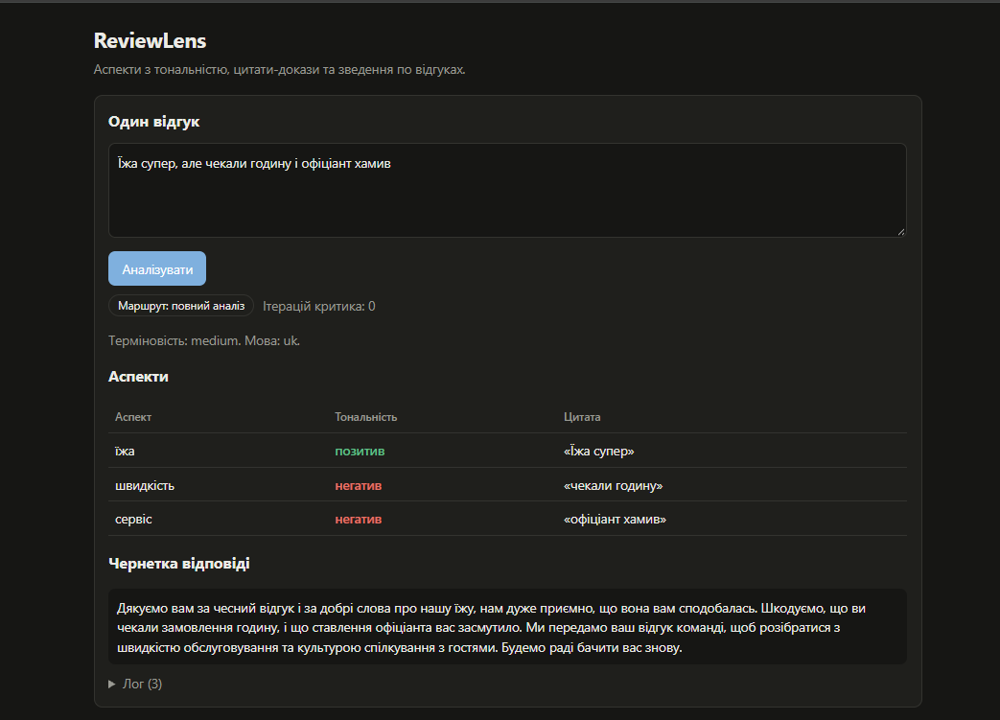
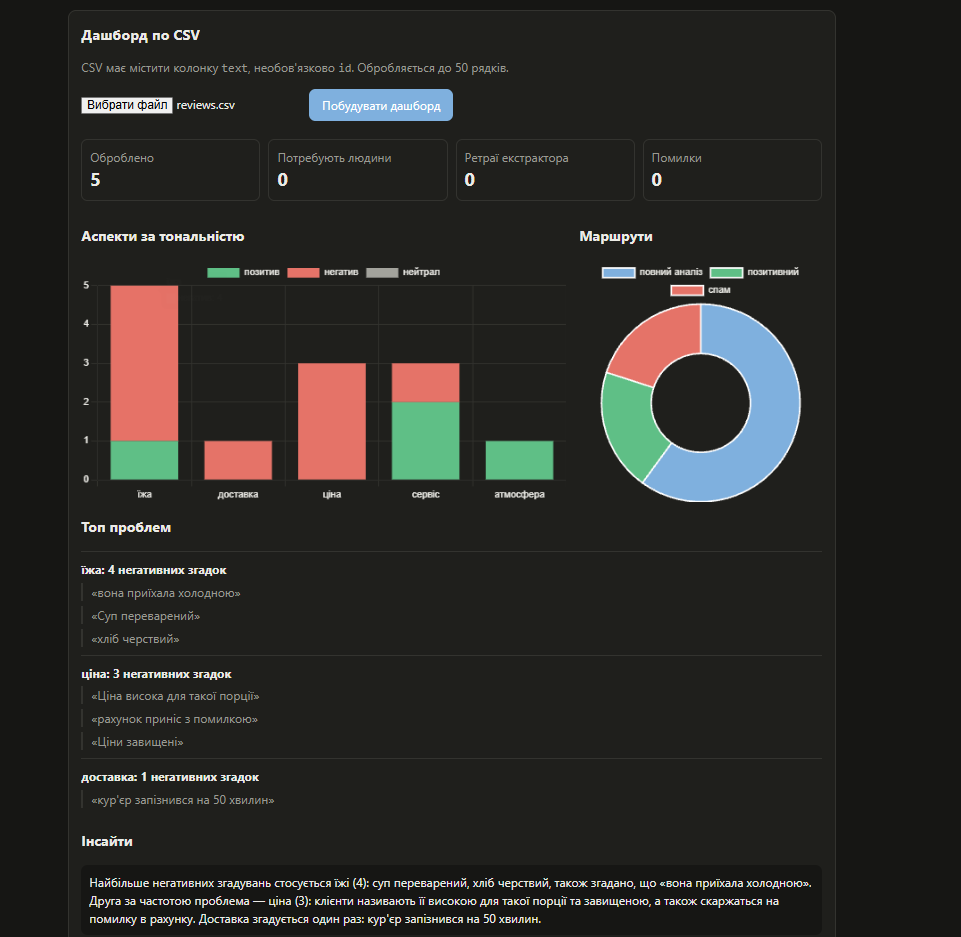

# ReviewLens

Аналіз відгуків клієнтів про заклад або товар. Кожен відгук розбивається на аспекти (їжа, сервіс, ціна, швидкість...) з тональністю і цитатою-доказом, яку перевірено по оригіналу. По CSV з багатьма відгуками дашборд показує, що саме не так: лічильники, топ проблем з цитатами і короткий LLM-висновок.

**Для кого:** власник кафе, магазину чи сервісу, який отримує сотні відгуків і не бачить, що саме в нього не так.

## Можливості

- **Один відгук:** маршрут, таблиця аспектів (колір за тональністю, цитата), чернетка відповіді, лог ретраїв валідації і зауважень критика.
- **Дашборд по CSV:** графіки Chart.js (аспекти за тональністю, маршрути), топ-3 проблеми з цитатами, блок «Інсайти».
- **Автодокументація API:** `http://localhost:8000/docs`.

Скріни (ще не додані в репозиторій):





## Архітектура

```
Відгук
  │
  ▼
[1. ROUTER] ──► spam → ігнор
  │         ──► escalate (суд, отруєння, травма...) → людині, без автовідповіді
  │         ──► positive → коротка подяка
  │         ──► full → повний пайплайн
  ▼
[2. EXTRACTOR] аспекти + тональність + цитати (JSON)
  ▼
[3. VALIDATOR] схема Pydantic, цитата є в оригіналі, дублі пар склеюються; інакше retry з текстом помилки
  ▼
[4. REPLY WRITER] чернетка відповіді
  ▼
[5. CRITIC] тон, вигадані обіцянки, покриття аспектів → переписування (до 2 ітерацій)
  ▼
FastAPI → веб-сторінка (один відгук / дашборд по CSV)
                                   │
                                   ▼
                    [6. INSIGHTS] агреговані цитати → короткий висновок
```

- **Router** (`reviewlens/router.py`): LLM класифікує відгук, поверх нього keyword-страховка на ескалацію (суд, адвокат, отруїли, поліція, лікарня) з останнім словом.
- **Extractor** (`reviewlens/extractor.py`): structured output, перевірка схеми і цитат, до 3 спроб. Повторні пари (аспект, тональність) склеюються після перевірки, лишається перша цитата.
- **Replier** (`reviewlens/replier.py`): writer, critic і rewrite. Якщо критик не відповів валідним JSON, чернетка вважається схваленою.
- **Insights** (`reviewlens/insights.py`): модель бачить лише топ-цитати і лічильники, не весь CSV.
- **Кеш** (`reviewlens/cache.py`): відповіді LLM у `.cache/`, ключ = хеш моделі, промптів і тексту. Повторні запуски не палять токени.

## Стек

| Що | Чим | Чому |
|---|---|---|
| Мова | Python 3.11+ | стандарт |
| LLM | Claude API, `claude-haiku-5-5` (змінна `LLM_MODEL`) | добра українська, стабільний JSON, дешево |
| Валідація | Pydantic v2 | схема і власні перевірки |
| Бекенд | FastAPI + Uvicorn | чіткий API з автодокументацією |
| Фронтенд | один `index.html`, чистий JS, Chart.js з CDN | без npm і збірки |
| Дані | pandas | агрегація для дашборда |
| Тести | pytest + скрипт оцінки `eval/run_eval.py` | цифри для захисту |

## Запуск

Команди запускати з кореня проєкту `reviewlens/`.

```
python -m venv .venv
.venv\Scripts\activate
pip install -r requirements.txt
copy .env.example .env      # вписати ANTHROPIC_API_KEY
uvicorn server:app --reload
```

Далі `http://localhost:8000` (сторінка) і `http://localhost:8000/docs`.

Тести без викликів API:

```
python -m pytest -q
```

Оцінка на розміченому наборі (реальний запуск викликає API, кеш пришвидшує повторні):

```
python eval/run_eval.py --fake --out <файл>   # фейковий LLM, без API
python eval/run_eval.py                        # реальний запуск
```

Ключ API береться тільки з `.env` або змінних оточення, у коді його немає. `.env` і `.cache/` у `.gitignore`.

## Дані

- **Джерело:** Hugging Face, датасет `vkovenko/cross_domain_uk_reviews` (commit `727a8d2e`, файл `processed_data.csv`). Використано ресторанні відгуки (`tripadvisor_restaurants_ukraine`). За описом датасету, зібрані з Tripadvisor.
- **Ліцензія:** у картці датасету `license: cc` без уточнення версії. Перед публікацією або комерційним використанням треба перевірити умови датасету і Tripadvisor.
- **Машинний переклад:** усі ресторанні відгуки в датасеті перекладені. Текст у `data/reviews.csv` узято з колонки `review_translate`. Оригінальну мову ми не перевіряли.
- **Обсяг:** `data/reviews.csv` містить 42 відгуки: 35 реальних і 7 синтетичних (`synthetic=true`). Синтетичні написані вручну: сарказм, суржик, спам, «ну таке», мультиаспектний відгук і дві ескалації. Синтетичні відгуки в тексті позначені чесно, у `reviews.csv` є колонка `synthetic`.
- **Gold (`data/gold.json`):** 22 відгуки, розмічені вручну: 12 `full`, 7 `positive`, 2 `escalate`, 1 `spam`. Для спаму аспекти порожні. Для aspect-метрик враховано 21 немспам-відгук. Розмітка перевірена вручну. Склад: 15 реальних відгуків (id 1–31 з CSV) і 7 синтетичних (id 36–42). Метрики рахуються на обох частинах разом, окремо їх не розділено.
- **Вибірка:** seed 42, по 7 відгуків на кожну оцінку 1–5, серед них короткі, довгі і з кількома аспектами. Два відгуки з склеєними словами (id 2 і 21 у ранній версії) замінено на інші з того ж фрагмента датасету з тією ж оцінкою.

## Результати оцінки

Оцінка на 22 відгуках з `data/gold.json`. Повна таблиця і список помилок: `eval/results.md`. Версія v1 збережена в `eval/results_v1.md`.

| Метрика | v1 | v2 |
|---|---|---|
| Router accuracy | 19/22 = 86.4% | 22/22 = 100.0% |
| Aspect precision | 53/69 = 76.8% | 53/63 = 84.1% |
| Aspect recall | 53/56 = 94.6% | 53/56 = 94.6% |
| Sentiment accuracy | 53/55 = 96.4% | 53/55 = 96.4% |
| Validation retry rate | 0/21 = 0.0% | 2/21 = 9.5% |
| Quote validity (1-ша спроба) | 21/21 = 100.0% | 21/21 = 100.0% |
| Critic effect | 3/15 = 20.0% | 2/12 = 16.7% |

Що означають метрики:
- **Aspect precision / recall:** пари (аспект, тональність) рахуються мультимножиною, тож два різні записи одного аспекту (id 13: food negative і food positive) враховуються окремо.
- **Sentiment accuracy:** серед аспектів, знайдених за назвою, частка з правильною тональністю.
- **Validation retry rate:** частка відгуків, що дійшли до extractor, з хоча б однією невдалою спробою.
- **Quote validity (1-ша спроба):** частка відгуків, де перша відповідь extractor не містила цитати, якої немає в тексті. Після ретраїв цитати завжди валідні, бо інакше відгук не проходить.
- **Critic effect:** частка чернеток, відхилених критиком хоча б раз.

Набір малий: 22 відгуки, один прогін. Різниця в 1–2 відгуки змінює відсоток суттєво. Цифри варто подавати як орієнтир, не як точну статистику.

## Відомі помилки та обмеження

**Дубли аспектів (v1).** Extractor повертав одну й ту саму пару кілька разів. У відгуку id 31 (ресторан, усе добре) було 7 пар замість 3, у id 9 і id 4 теж дублі. Precision у v1 становила 76.8%. У v2 промпт вимагає одну пару на аспект і тональність, а код склеює дублі після перевірки цитат. Precision стала 84.1%, recall не змінився.

**Що лишилось у v2:** зайві аспекти (`other`, `atmosphere`, лишній `food` з іншою тональністю) у відгуках id 8, 9, 16, 20, 26, 28 і 31. Роутер у v2 правильний на всіх 22 відгуках.

**Сарказм.** Є один сарказмний відгук у gold (id 36, синтетичний: «Ну звісно, чудово: годину чекали столика...»). І v1, і v2 віднесли його до `full` з правильними аспектами. Це один приклад, тому висновку «сарказм розпізнається» з нього не зробиш. Систематичного набору сарказму немає. Очікуваний ризик: лексика «чудово» і «дякую» без іронії може дати `positive` замість `full`. Покращення: few-shot із сарказмом, рейтинг як додатковий сигнал.

**Машинний переклад.** Відгуки перекладено машиною. Аспекти і цитати знаходяться в перекладеному тексті, тож помилки перекладу можуть давати хибні аспекти або цитати. Ми не перевіряли відповідність перекладу оригіналу, тому конкретних прикладів таких помилок у нас немає. Для захисту чесно сказати: метрики міряють якість на перекладі, а не на оригіналі.

**Синтетичні відгуки** (id 36–42) входять у gold, і метрики рахуються разом з реальними. За таблицями помилок: у v1 синтетика давала одну помилку (id 39, тональність ціни), у v2 жодної. Синтетики мало (7), тож це не доказ, що система добре працює на вигаданих складних випадках.

**Критик** теж LLM. Він може пропустити тонку вигадану обіцянку. Валідатор цитат це не покриває: критик перевіряє тон і обіцянки, а не факти.

**Інсайти** можуть узагальнити надто сміливо. Тому модель отримує лише цитати і лічильники, але висновок усе одно варто перечитати.

## Що далі

- Few-shot із сарказмом і рейтингом як додатковим сигналом.
- Порівняння моделей (Haiku, Sonnet) на тому самому gold.
- Ембедінги для кластеризації тем замість фіксованого списку аспектів.
- Перевірка ліцензії датасету перед публікацією.
