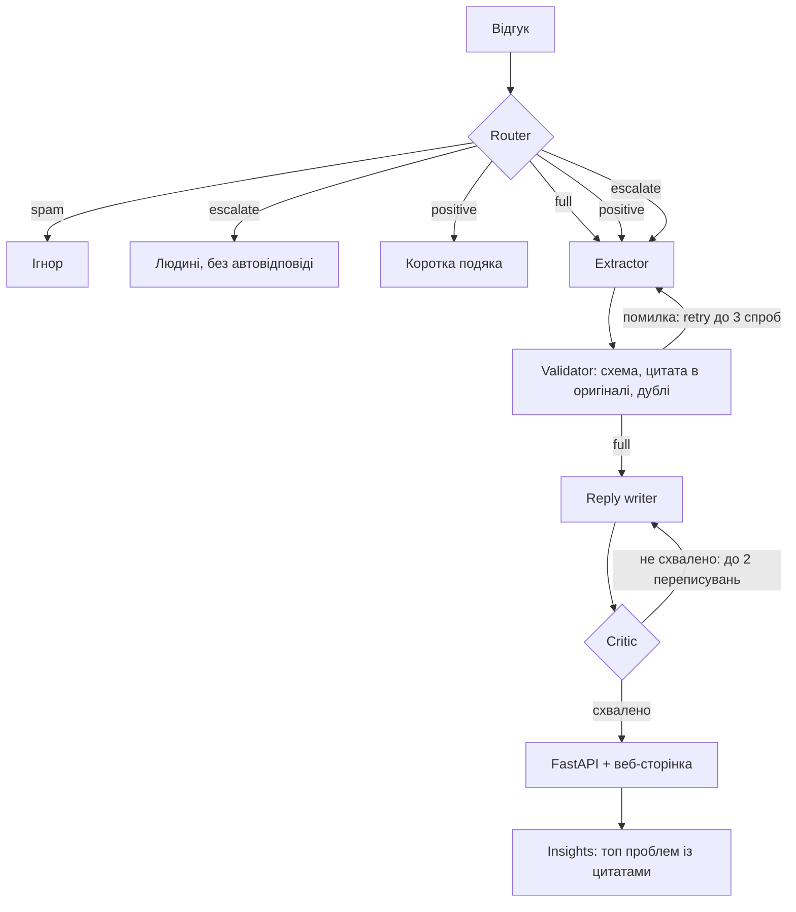

# ReviewLens

Розбирає відгуки клієнтів на аспекти з тональністю і перевіреними цитатами та показує власнику закладу, що саме в нього не так.


## Архітектура



Router доповнено keyword-страховкою на ескалацію (суд, адвокат, отруїли, поліція, лікарня), яка має останнє слово. Відповіді LLM кешуються в `.cache/`.

## Стек

| Що | Чим | Чому |
|---|---|---|
| LLM | Claude API, `claude-haiku-5-5` (змінна `LLM_MODEL`) | не потрібен GPU, добра українська, дешево |
| Валідація | Pydantic v2 | схема і власні перевірки |
| Бекенд | FastAPI + Uvicorn | чіткий API, автодокументація `/docs` |
| Фронтенд | один `index.html`, чистий JS, Chart.js (CDN) | без npm і збірки |
| Тести | pytest + `eval/run_eval.py` | цифри для оцінки |

## Швидкий старт (Windows)

З кореня проєкту:

```
python -m venv .venv
.venv\Scripts\activate
pip install -r requirements.txt
copy .env.example .env
```

Впиши `ANTHROPIC_API_KEY` у `.env`, далі:

```
uvicorn server:app --reload
```

Сторінка: http://localhost:8000, API-документація: http://localhost:8000/docs.

Тести (без викликів API): `python -m pytest -q`

Оцінка якості на розмічених даних:

```
python eval/run_eval.py --fake --out <файл>   # фейковий LLM: без API і без запису в кеш
python eval/run_eval.py                        # реальний запуск через Claude API (кеш у .cache/)
```

## Результати

Оцінка на 22 розмічених відгуках (`eval/results.md`, v1 у `eval/results_v1.md`).

- **Router accuracy:** маршрут збігся з gold, усі 22 відгуки.
- **Aspect precision / recall:** пари (aspect, sentiment), лише немспам-відгуки gold (21); пари рахуються мультимножиною, тож дубль аспекту (id 13) не губиться.
- **Sentiment accuracy:** серед аспектів, знайдених за назвою, частка з правильною тональністю.
- **Validation retry rate:** частка відгуків, що дійшли до extractor (маршрут не spam), у яких була хоча б одна невдала спроба.
- **Quote validity:** частка відгуків, де перша відповідь extractor не містила цитати, якої немає в тексті (знаменник той самий).
- **Critic effect:** частка чернеток (маршрут full з відповіддю), які критик відхилив хоча б раз.

| Метрика | v1 | v2 |
|---|---|---|
| Router accuracy | 19/22 = 86.4% | 22/22 = 100.0% |
| Aspect precision | 53/69 = 76.8% | 53/63 = 84.1% |
| Aspect recall | 53/56 = 94.6% | 53/56 = 94.6% |
| Sentiment accuracy | 53/55 = 96.4% | 53/55 = 96.4% |
| Validation retry rate | 0/21 = 0.0% | 2/21 = 9.5% |
| Quote validity (1-ша спроба) | 21/21 = 100.0% | 21/21 = 100.0% |
| Critic effect | 3/15 = 20.0% | 2/12 = 16.7% |

**Висновок:** зміна промптів і склейка дублів пар підняли router до 100% і precision з 76.8% до 84.1%, recall і тональність не змінились.

## Приклад результату

Синтетичний відгук (id 36, сарказм): *«Ну звісно, чудово: годину чекали столика, а коли нарешті сіли, нам принесли холодний борщ. Дякую, що не дали нам померти з голоду швидко.»*

```json
{
  "route": "full",
  "extraction": {
    "aspects": [
      {"aspect": "speed", "sentiment": "negative", "quote": "годину чекали столика"},
      {"aspect": "food", "sentiment": "negative", "quote": "холодний борщ"}
    ],
    "urgency": "medium",
    "language": "uk",
    "needs_human": false
  },
  "reply": "Вибачте, що вам довелося годину чекати на столик, а потім отримати холодний борщ. Ми розуміємо, що це зіпсувало ваш вечір, і передамо ці зауваження команді, щоб швидкість обслуговування та температуру страв переглянули. Дякуємо, що поділилися відгуком, нам важливо знати про такі речі.",
  "iterations": 0,
  "logs": [
    "Router: full. сарказм приховує скарги на годинне очікування столика і холодний борщ",
    "Writer: чернетку написано",
    "Critic: схвалено після 0 переписувань"
  ],
  "needs_human": false
}
```

## Дашборд

CSV з колонкою `text` (до 50 рядків): аспекти за тональністю, маршрути, топ-3 проблеми з цитатами, короткий LLM-висновок.


## Дані

- **Джерело:** Hugging Face, `vkovenko/cross_domain_uk_reviews`, ресторанні відгуки (Tripadvisor).
- **Машинний переклад:** усі ресторанні відгуки в датасеті перекладені машиною; брали колонку `review_translate`. Метрики відображають якість на перекладі, а не на оригіналі.
- **Обсяг:** `data/reviews.csv`: 42 відгуки, з них 7 synthetic (колонка `synthetic`): сарказм, суржик, спам, «ну таке», мультиаспектний відгук, дві ескалації.
- **Gold:** `data/gold.json`, 22 відгуки, розмітка перевірена вручну. Реальні й synthetic рахуються разом.
- **Ліцензія:** у картці датасету `license: cc` без версії. Перед публікацією чи комерційним використанням перевір умови датасету і Tripadvisor.

## Обмеження

- **Малий набір:** 22 відгуки, один прогін. Різниця в 1–2 відгуки помітно міняє відсотки, цифри є орієнтиром.
- **Зайві аспекти:** у v2 лишились у відгуках id 8, 9, 16, 20, 26, 28, 31 (`other`, `atmosphere`, зайвий `food` з іншою тональністю).
- **Сарказм:** у gold один приклад (id 36), його оброблено правильно, але висновку про загальну якість з нього не зробиш.
- **Переклад:** помилки машинного перекладу можуть давати хибні аспекти; ми не звіряли переклад з оригіналом.
- **Synthetic у gold:** 7 вигаданих відгуків змішано з реальними, окремо метрики не рахувались.
- **Критик і інсайти:** обидва LLM; критик може пропустити тонку вигадану обіцянку, інсайти можуть узагальнити надто сміливо. Результат варто перечитувати.
- **Ліміт:** дашборд обробляє до 50 рядків за запит.
